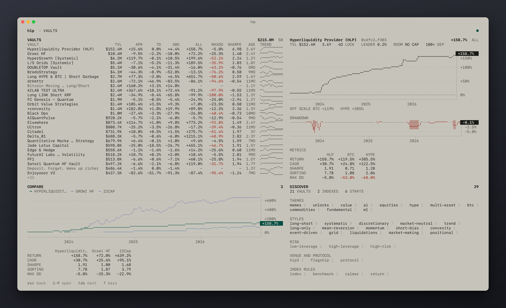
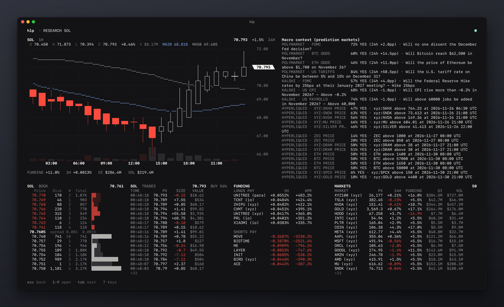
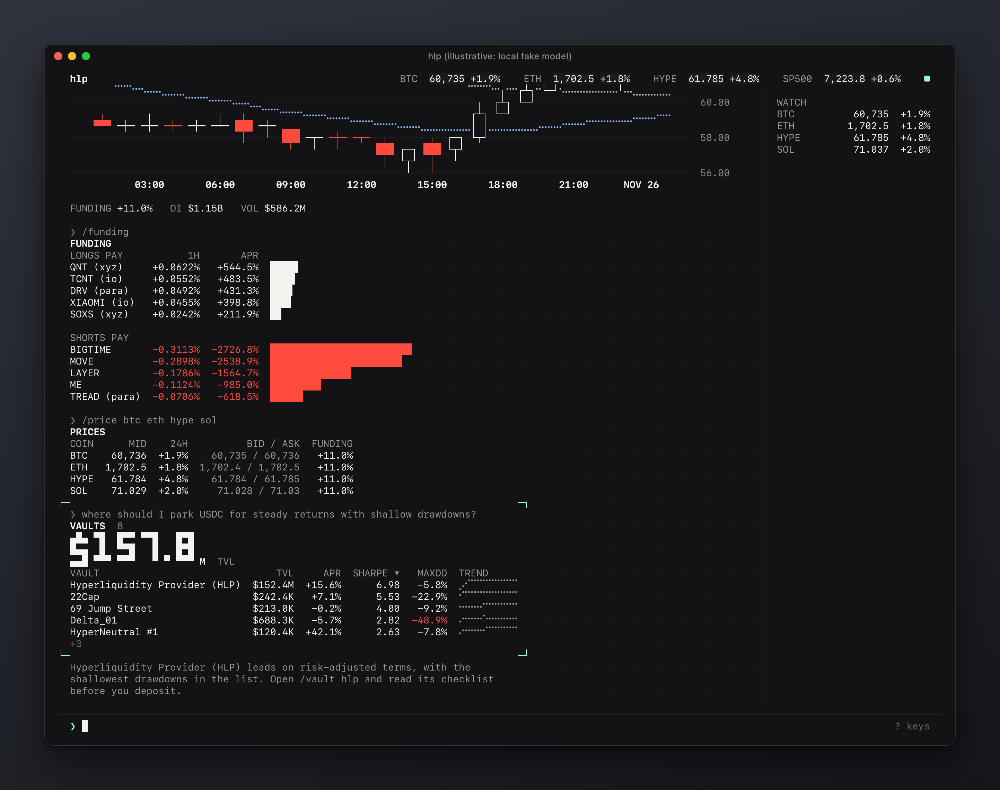

<div align="center">

# hlp cli

**The Hyperliquid terminal for vaults.**

Rank every vault, read its tearsheet, backtest your own thesis or Pine script, and watch AI
strategies trade on paper. Candlestick charts, a JSON CLI and an MCP server included.

[](https://github.com/maxmoneycash/hlp-cli/releases)
[](https://github.com/maxmoneycash/hlp-cli/actions/workflows/ci.yml)
[](LICENSE)


</div>

```sh
curl -fsSL https://raw.githubusercontent.com/maxmoneycash/hlp-cli/main/install.sh | sh
```

No keys, no account, no sign-up. Everything reads public data until you opt in.

> **Status: pre-release.** All market and vault data is live mainnet data. Trading is dry-run only in
> this build: orders are built, risk-checked and previewed, never sent. Strategies, bots and the
> arena run on **paper**.

## Install

```sh
curl -fsSL https://raw.githubusercontent.com/maxmoneycash/hlp-cli/main/install.sh | sh  # macOS and Linux, verifies SHA-256
go install github.com/maxmoneycash/hlp-cli/cmd/hlp@latest                               # Go 1.27+
```

Or download a binary from [Releases](https://github.com/maxmoneycash/hlp-cli/releases) and check it against
`checksums.txt`. Every release archive also carries signed build provenance:
`gh attestation verify hlp_<version>_<os>_<arch>.tar.gz -R maxmoneycash/hlp-cli`, or run `install.sh` with
`HLP_INSTALL_VERIFY=1` to have it check that for you. Archives include shell completions
(`completions/`) and the licences of every bundled dependency (`third_party_licenses/`).

Binaries are not notarized yet. `install.sh` downloads with curl, which does not set the macOS
quarantine flag (it removes one if a mirror or wrapper set it, and says so). The Windows `.exe` is unsigned, so SmartScreen may warn on its first run.

From source:

```sh
git clone https://github.com/maxmoneycash/hlp-cli && cd hlp
make build          # writes bin/hlp
./bin/hlp --help
```

## Quick start (30 seconds)

```sh
hlp                                            # the shell: try /chart HYPE 15m, /vaults, /vault hlp
hlp price btc eth                              # mid, bid/ask, mark, 24h change, funding
hlp chart BTC 1h                               # candles, volume, MAs, 24h change, funding, OI
hlp vaults --min-tvl 100k --sort sharpe        # every vault over $100k, ranked
hlp vault "Long HYPE & BTC"                    # tearsheet vs HLP, BTC and HYPE, with a checklist
hlp backtest --thesis "long BTC, short DOGE FARTCOIN, rebalance 1w" --days 90
```

Every command prints a card in a terminal and a JSON envelope in a pipe:

```sh
hlp vaults --select name,tvl,sharpe --limit 5 | jq
```

## Screenshots

| | |
|---|---|
| <br>**Markets** | <br>**Vaults** |
| <br>**HLP** | <br>**Strategies** |
| <br>**Research** | <br>**Hyperliquid theme** |
| <br>**Paper theme** | <br>**Heikin-Ashi** |
| <br>**Shell** | <br>**Ask (illustrative)** |

## What you get

| | |
|---|---|
| [Charts](#charts) | Candlesticks for any perp, spot or HIP-3 market, in the shell or on stdout |
| [Vault analytics](#vault-analytics) | Screener over every vault, tearsheets, compare, HLP's live book |
| [Strategy vaults](#strategy-vaults-and-thesis-backtests) | Thesis baskets in YAML or plain English, backtested with fees and funding |
| [Pine import](#pine-import) | Paste a TradingView-style strategy, check it, run it on Hyperliquid candles |
| [AI agent and MCP](#ai-agent-and-mcp) | Chat with your own model, or drive hlp from Claude Code, Cursor or Codex |
| [AI vs AI arena](#ai-vs-ai-arena) | Local models, Pine scripts and theses on one live feed, on paper |

## Charts

<!-- not rendered yet (`make gifs` / commit docs/images, then restore):  -->

Candles with hollow up bodies and solid red down bodies, moving averages behind them, volume, a live
last-price tag and a crosshair. The price leads in big digits. Any perp, spot or HIP-3 market
(`xyz:SP500`, `xyz:NVDA`).

```sh
hlp chart HYPE 15m --ma 20,50          # simple moving averages; --ema for exponential
hlp chart xyz:SP500 1d --style heikin  # styles: blocks, lines, half, mono, ascii, heikin
hlp chart BTC 4h --address 0xdfc24b077bc1425ad1dea75bcb6f8158e10df303
                                       # overlay an account's entries, liqs, orders (HLP trades through child vaults)
hlp chart BTC 15m --height 30 --zoom 2 # size and zoom the inline chart
hlp book ETH                           # L2 book with depth bars
hlp book ETH -w --max-events 20        # live; stop after N updates (or --for 1m, or ctrl+c)
hlp funding                            # funding ranking across every market
hlp markets --sort volume              # perps, HIP-3 and spot with 24h change, funding, OI
```

In the shell, Enter on an empty prompt opens the newest card full screen. Chart keys: `h`/`l` pan,
`+`/`-` zoom, `1`-`9` interval, `c` crosshair, `s` style, `i` MAs, `L` log scale, `esc` back.

On the legacy Windows console (cmd.exe without Windows Terminal), braille and eighth blocks render
badly: use `--style ascii` or `chart.style = "ascii"` in config.

**Themes.** `rush` (default: ink on near-black, one Hyperliquid mint accent), `paper`, `hlp`, `hyperliquid`,
`light`, `tokyonight`, `catppuccin`, `gruvbox`, `mono` and a `colorblind`-safe palette. `ctrl+t`
cycles them; `--theme <name>` picks one.

## Vault analytics

<!-- not rendered yet (`make gifs` / commit docs/images, then restore):  -->

The screener merges every Hyperliquid vault (stats-data) with hlp.xyz's curated metrics. Defaults
hide closed vaults, HLP's child vaults and anything under $10k. Risk filters never pass a vault whose
metric is unknown.

A curated registry ships inside the binary (`vaults.toml`: HyperCore vaults, HyperEVM strategy
vaults, hlp.xyz indexes and quant strategies) with tags for themes, styles and risk. Add your own
entries, tags or hidden vaults in `~/.config/hlp/vaults.toml` next to `config.toml`; same schema.

```sh
hlp vaults --sort sharpe --max-dd 20 --open   # deposits open, drawdown under 20%
hlp vaults growi                              # fuzzy search (lifts the TVL floor)
hlp vaults discover                           # curated tags with counts: memes, trend, market-neutral…
hlp vaults --tag memes                        # curated vaults with a tag, with live numbers
hlp vault hlp                                 # HLP itself
hlp vault compare hlp "Long HYPE & BTC"       # curves, metrics and correlation side by side
hlp hlp                                       # what HLP is long and short right now
hlp index                                     # hlp.xyz vault indexes
```

A tearsheet shows the share-price curve against HLP, BTC and HYPE, an underwater drawdown, monthly
returns, CAGR, Sharpe, Sortino, max drawdown and Calmar, current exposure, and a due-diligence
checklist with pass, warn and fail marks:

| Question | Where hlp answers it |
|---|---|
| Does it beat HLP risk-adjusted? | `vs HLP` row of the checklist, Sharpe column |
| How deep did it fall? | drawdown pane, Max DD, Calmar |
| Does the leader have skin in the game? | `Leader stake`, deposit room under the 5% rule |
| Is the money in a few hands? | `Concentration` of the top 10 depositors |
| What is it holding right now? | exposure bars, or `hlp watch <address>` live |

Two Sharpe numbers, two labels: the screener shows hlp.xyz's number ("sharpe"), the tearsheet also
shows ours from daily returns ("sharpe (daily)"). `--json` has both.

## Strategy vaults and thesis backtests

A thesis is a weighted long/short basket in YAML or plain English. Backtests run on Hyperliquid
candles with taker fees, slippage and hourly funding, and print the same tearsheet as a vault, so
"my idea vs that vault vs HLP" is one view.

```yaml
# examples/thesis/long-spy-short-memes.yaml
name: Long SPY / Short memes
interval: 1d
rebalance: 1w
leverage: 1.95
long:
  - coin: xyz:SP500
    weight: 1.5
short:
  - basket: memes
    weight: 0.45
baskets:
  memes: [DOGE, FARTCOIN, TRUMP, PUMP, CASHCAT, PONS]
```

```sh
hlp backtest examples/thesis/long-spy-short-memes.yaml --days 180
hlp backtest --thesis "long xyz:SP500 1.5x, short DOGE FARTCOIN TRUMP, rebalance 1w"
hlp strat spxmeme                  # hlp.xyz's live quant book for the same idea
hlp fund                           # strategy vault on HyperEVM, read on-chain: NAV, share price, epoch, fees, bot
hlp fund epochs                    # settled epochs: price, NAV, deposits, redemptions, fees
hlp fund user 0x7ffb5ea882eec736200c51209d668a6972092000   # one depositor's shares and redeem preview
```

`hlp fund` (alias `pvault`) reads strategy vaults straight from HyperEVM over public RPC: the hlp.xyz
async-deposit vault protocol, today the Trend Pyramid prototype on testnet (chain 998). It never
signs anything. Point it at other RPCs with `--rpc` or `[hyperevm.998] rpc = [...]` in config.

The first backtest downloads hourly funding for every leg, which Hyperliquid rate-limits; progress
shows on stderr and finished windows are cached, so reruns are quick. More theses live in
[`examples/thesis/`](examples/thesis/).

## Pine import

<!-- not rendered yet (`make gifs` / commit docs/images, then restore):  -->

Pine v5 and v6 strategies run locally: `ta.*`, `strategy.entry/exit/close` (with trailing stops),
inputs, `var` state, `switch`, user functions with default and named arguments, `timestamp()` and
`plot`. `request.security` works for the same coin at the chart's timeframe or a higher one (closed
bars only, no look-ahead). Paste a script exported from TradingView's Pine Editor and `check` lists
anything unsupported with `line:col`, never a silent wrong result. Not supported yet: other symbols,
lower timeframes, arrays, maps, matrices, tables and labels.

```sh
hlp pine check examples/pine/tradingview-import.pine
hlp pine run examples/pine/supertrend.pine --coin HYPE --interval 1h
hlp backtest my-strategy.pine --coin BTC --interval 1h
```

Seven original example strategies are in [`examples/pine/`](examples/pine/). Results include losing
ones; a strategy that looked good on another exchange may not survive Hyperliquid fees and funding.

**Other engines (optional).** hlp's own Pine interpreter is the default (`--engine builtin`, MIT,
built in). You can also run a script through an engine you install yourself and compare the
results: `--engine pyne` runs [PYNE](docs/PYNE.md), and `--engine pineforge` runs the
[PineForge](docs/PINEFORGE.md) container. Neither is bundled, linked or downloaded by hlp: hlp starts
the program you installed, hands it your script and candles, and reads its report. Their licences
are theirs and apply to your use. PYNE is AGPL-3.0. PineForge's transpiler is source-available
(PineForge Source License): free for personal trading, not for managing other people's money, so
hlp shows its licence notice and runs it only after you accept it (`[pineforge] accept_license =
true` in config, or `--acceptPineforgeLicense` on the command). Set a default with `[strategy] engine`.
Agents and MCP clients get the built-in engine unless `[strategy] allow_external_engines = true`.

## AI agent and MCP

`hlp` with no arguments opens a chat-style shell: a transcript of cards, a prompt with fuzzy slash
completion, `ctrl+k` palette, `ctrl+b` watchlist, `ctrl+t` theme, `?` help. VS Code's terminal keeps
`ctrl+k`, `ctrl+b` and `ctrl+o` for itself: use `/` commands there, or turn on
`terminal.integrated.sendKeybindingsToShell`. Windows Terminal takes `alt+enter` for full screen. Plain words work with no
model at all ("chart btc 4h", "top vaults by sharpe", "funding"). Add a model and the assistant can
call every read-only tool and answer with live cards.

`/dash markets`, `/dash vaults`, `/dash hlp`, `/dash strategies` and `/dash research` open live
dashboards; add a coin (`/dash markets ETH`). `1`-`9` opens a tile full screen, `tab` moves to the next.

<!-- not rendered yet (`make gifs` / commit docs/images, then restore):  -->

Bring your own model in `~/.config/hlp/config.toml`. Local models need no key; hlp never ships or
proxies one.

```toml
[llm]
provider = "ollama"          # ollama, lmstudio, openai-compatible, anthropic or openrouter
model = "qwen3:8b"
# anthropic reads ANTHROPIC_API_KEY; openai-compatible reads OPENAI_API_KEY;
# openrouter reads OPENROUTER_API_KEY (model = "anthropic/claude-sonnet-5", any id from `hlp arena models`)

[macro]
disabled = false             # prediction-market context for LLM bots in paper and arena runs
# sources = ["hyperliquid", "polymarket", "kalshi"]
```

### Use hlp from your coding agent

`hlp mcp` serves every read-only tool on stdio: `list_vaults`, `get_vault`, `compare_vaults`,
`get_candles`, `get_tick_candles`, `get_orderbook`, `get_markets`, `get_funding`, `get_account`, `get_fills`,
`hlp_positioning`, `discover_vaults`, `get_strategy_vault`, `run_backtest`, `run_pine`, `pine_check`,
`paper`, `arena`, `get_price`, `preview_order`, `status`, `schema` and more (35 tools). Trading tools are not listed unless you turn them on twice (see [Safety](#safety)).

**Claude Code**

```sh
claude mcp add hlp -- hlp mcp
```

**Cursor** (`~/.cursor/mcp.json`, or `.cursor/mcp.json` in a project)

```json
{
  "mcpServers": {
    "hlp": { "command": "hlp", "args": ["mcp"] }
  }
}
```

**Codex** (`codex mcp add hlp -- hlp mcp`, or `~/.codex/config.toml`)

```toml
[mcp_servers.hlp]
command = "hlp"
args = ["mcp"]
```

Then ask: *"Find Hyperliquid vaults over $1M with drawdown under 20% that beat HLP risk-adjusted;
cite meta.asOf."*

<!-- not rendered yet (`make gifs` / commit docs/images, then restore):  -->

**Skill.** [`skills/hlp/SKILL.md`](skills/hlp/SKILL.md) teaches an agent the JSON contract and the
tools. `hlp skill` prints it, and `hlp skill --install claude` (or `codex`, `cursor`) copies it into
that agent's skills folder.

**JSON contract** (the CLI, for scripts and agents without MCP):

| | |
|---|---|
| Output | `{"data":…,"meta":{"source","asOf","stale","network","warnings"}}` on stdout; automatic when piped, or `--json` / `HLP_JSON=1` |
| Errors | `{"error":{"code","message","hint","details"}}` on stderr |
| Shaping | `--select a,b.c` (paths map over lists: `positions.coin`), `--limit N`, `-q` bare values, `--results-only`, `--csv`, `--plain` for no ANSI |
| Streams | `-w`/`--live` to follow updates, `--ndjson` for one JSON line per update, bounded by `--max-events N` or `--for 30s`; piped `--json` gives one snapshot and exits |
| Agent mode | Under a coding agent (`AI_AGENT`, `CLAUDECODE`, `CODEX_SANDBOX`, `CURSOR_AGENT`, `GEMINI_CLI`) results are agent-sized like MCP's: bulky series dropped, long lists downsampled, 64 KB cap, every cut in `meta.warnings`. `--compact` / `HLP_COMPACT=1` turns it on anywhere, `--full` / `HLP_COMPACT=0` off |
| Discovery | `hlp schema` lists tools; `hlp schema get_vault` (or `hlp vault --help --json`) prints input and output JSON Schema; a mistyped command gets a "did you mean" hint |
| Exit codes | `0` ok · `1` error (network, upstream, not found) · `2` usage, including an unknown coin, vault or file · `3` refused by safety · `4` retryable (rate limited or upstream 5xx; the error has `"retryable":true` and, when known, `details.retryAfterMs`). A `--dry-run` preview exits `0` even when a risk check fails; the failed check is in the card and in `data.checks` |

## AI vs AI arena

<!-- not rendered yet (`make gifs` / commit docs/images, then restore):  -->

Several strategies, the same live feed, the same $10,000 of paper money: local LLM bots, Pine
scripts and theses on one leaderboard with return, Sharpe and max drawdown. Every entrant is a
simulated ledger filled against the live order book. No keys, no orders.

```sh
hlp arena --entrants examples/pine/ema-cross.pine@BTC,examples/pine/rsi-mean-revert.pine@ETH
hlp arena examples/arena/ai-vs-thesis.yaml --llm  # two local models vs Pine vs a thesis (Ollama: llama3.1:8b, qwen3:8b)
hlp arena --vaults hlp,"Long HYPE & BTC"          # real vaults head to head over 30 days
hlp arena models claude                           # OpenRouter model ids and price per 1M tokens
hlp arena --entrants llm:openrouter/anthropic/claude-sonnet-5,llm:openrouter/openai/gpt-5 --llm --max-llm-calls 100
```

Any run that calls a model more than once (arena, paper, backtest) needs `--llm`: without it hlp
prints the estimated call count and list-price cost and stops. Calls stop at `--max-llm-calls`
(default 200) for the whole run. One `OPENROUTER_API_KEY` runs every model OpenRouter lists, so a
multi-vendor arena needs one key. Every entrant reports `vsBench`, its growth relative to buy-and-hold of
the coins the entrants trade (`--bench BTC|HYPE|SP500` to change it). Bare `llm:<model>` entrants
scout up to 4 coins (crypto majors and HIP-3 equity perps), then decide in strict JSON with a
confidence, reason and evidence per trade; risk limits are enforced in code. In paper and arena
runs they also see prediction-market odds (`hlp macro`: Hyperliquid HIP-4, Polymarket, Kalshi) as
labelled context, never as a signal and never in backtests (`macro.disabled = true` turns it off).

<!-- not rendered yet (`make gifs` / commit docs/images, then restore):  -->

Run one strategy on its own as a paper vault. `hlp paper start` runs in the foreground; stop it
with ctrl+c and the ledger stays, so `paper list` and `paper status` show it afterwards:

```sh
ollama pull llama3.1:8b                                             # the arena example also needs qwen3:8b
hlp paper start llm:examples/llm/contrarian.yaml --id contrarian --llm   # a local model decides every hour
hlp paper start examples/pine/ema-cross.pine --coin BTC
hlp paper list
hlp paper status --id contrarian
```

Sessions persist locally, so a stopped session keeps its ledger. LLM bots decide once per closed bar;
a remote model is your choice and your key.

## Safety

- **Paper by default.** Backtests, paper sessions and the arena never place orders and need no keys.
- **Read-only by default.** Reading any account or vault needs only its public address.
- **Dry-run trading.** `hlp order`, `hlp close`, `hlp cancel` and vault deposit/withdraw build the
  action, check it against your risk caps and show a preview. This build cannot send: live sending
  is compiled out. After a manual testnet run of the order path it will ship
  behind an explicit `--live` flag, `trading.enabled = true` and an agent key, and nothing else.
- **Agent keys only, never your master key.** hlp signs with a Hyperliquid API wallet, which can
  trade but cannot withdraw. Keys come from `HLP_AGENT_KEY` or the OS keychain (`hlp auth set`
  reads stdin), never argv or config files, and are never logged. `hlp auth status` shows the public
  address only.
- **Risk caps on every order** from every surface (CLI, shell, assistant, MCP): max notional, max
  leverage, allowed coins, daily-loss halt.
- **A person confirms.** The assistant cannot approve its own orders. MCP trading tools exist only
  with `mcp.allow_trading = true` in config **and** `hlp mcp --allow-trading`.
- **Testnet one flag away:** `--testnet`. Nothing is custodial. No telemetry. Builder fees are off.

```sh
hlp preview buy HYPE --usd 100                   # never signed: ok, blockers and every risk check
hlp order buy HYPE --usd 100 --dry-run           # preview: size, price, every risk check
hlp order sell BTC 0.01 --px 120000 --tp +5% --sl -2% --dry-run
hlp auth status
hlp status                                       # API latency, WebSocket, rate-limit budget, config
```

## Configuration

`~/.config/hlp/config.toml`; `hlp config` prints the path and the effective config with secrets
redacted. Unknown keys are an error, so typos do not silently do nothing.

```toml
theme = "auto"                   # auto = rush
account = "0x…"                  # default address for /account and the watchlist
pinned_markets = ["BTC", "ETH", "HYPE", "xyz:SP500"]

[chart]
interval = "15m"
mas = [20, 50]

[risk]
max_notional_usd = 1000
max_leverage = 5
daily_loss_usd = 200
require_confirm = true
```

hlp uses hlp.xyz's public API for vault metrics (with a client-side rate limit and caching) and
Hyperliquid's own API for markets, accounts and live data, and as the fallback. Turn hlp.xyz off with
`[hlpxyz] disabled = true`.

## Roadmap

- **Next:** testnet trading behind `--live`, share cards (`--card` PNG for tearsheets and backtests),
  vault alerts (drawdown, leader withdrawals, TVL flight), arena sessions that resume by id.
- **Later:** strategy vault deploys on the hlp.xyz protocol, bots attached to real vaults,
  other symbols, arrays and maps in Pine, kitty/sixel pixel candles, translations.

## Credits

- Built on [Charm](https://charm.sh)'s Bubble Tea, Lip Gloss and Fang. The shell's layout takes its
  cues from [Crush](https://github.com/charmbracelet/crush).
- Market, account and vault data from [Hyperliquid](https://hyperliquid.xyz)'s public API; curated
  vault metrics from [hlp.xyz](https://www.hlp.xyz). hlp is built by the hlp.xyz team.
- The thesis format follows the "Long HYPE & BTC | Short Garbage" vault and hlp.xyz's spxmeme
  strategy. Pine semantics are checked against [PyneCore](https://github.com/PyneSys/pynecore).
- Demos are recorded with [VHS](https://github.com/charmbracelet/vhs) from the tapes in
  [`docs/tapes/`](docs/tapes/).

## Contributing

`make check` runs gofmt, vet and the tests (fixtures only, no network). See
[CONTRIBUTING.md](CONTRIBUTING.md), [SECURITY.md](SECURITY.md) for reporting vulnerabilities and
[`docs/ARCHITECTURE.md`](docs/ARCHITECTURE.md) for the architecture. The example strategies are explained in
[`examples/README.md`](examples/README.md).

## License

MIT. Not financial advice. A vault shown by name is public data, not an endorsement. hlp reads public
data by default and cannot send orders in this build.
