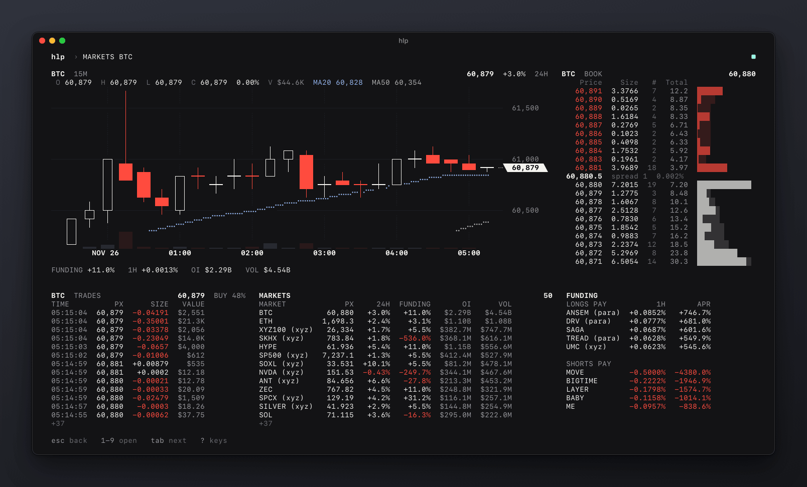
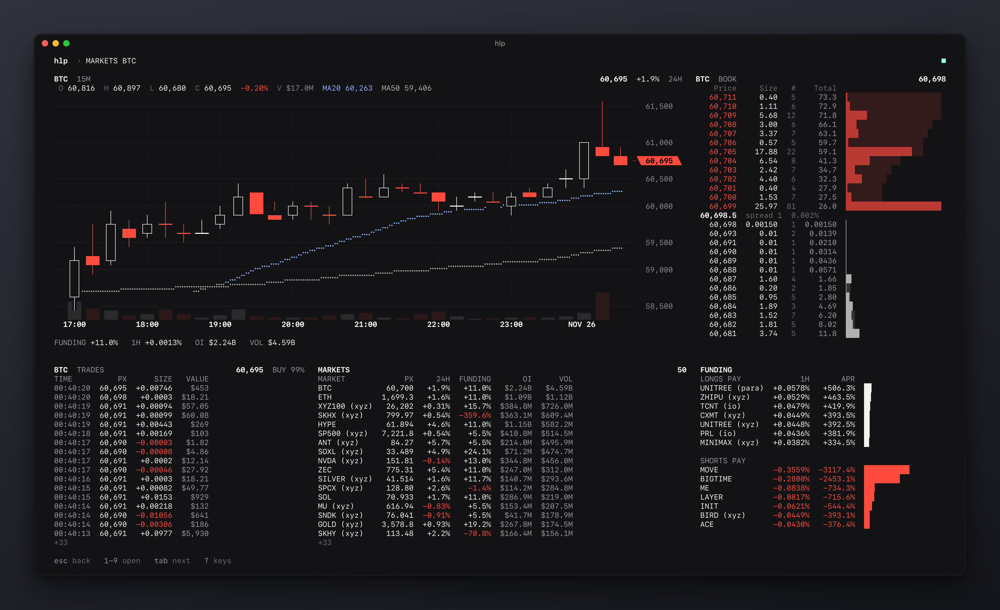
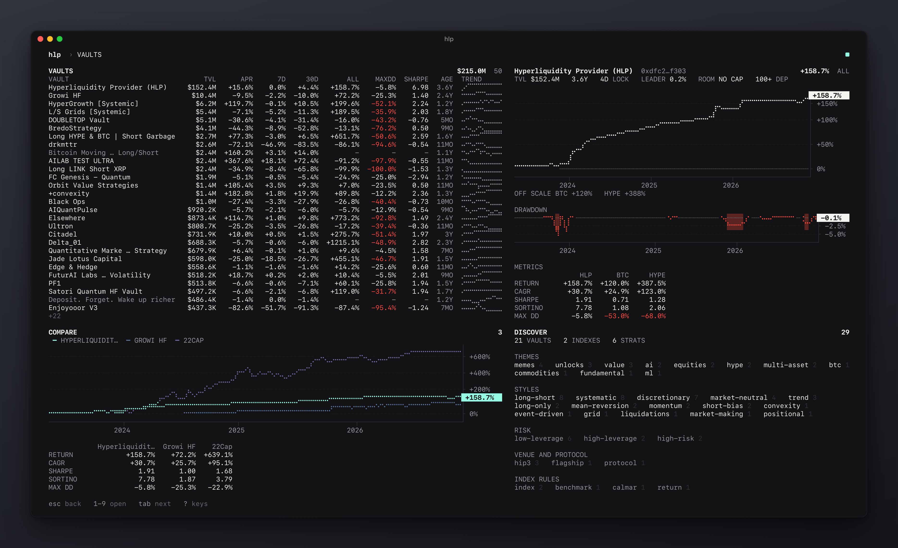
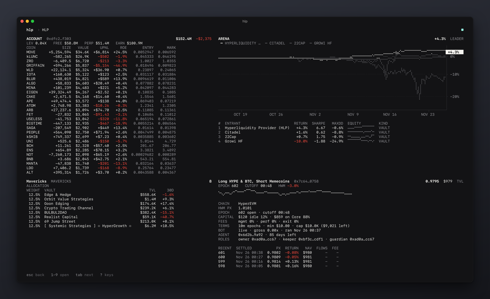
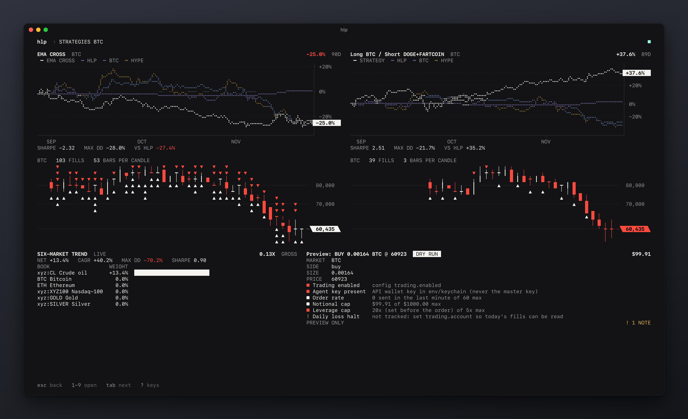
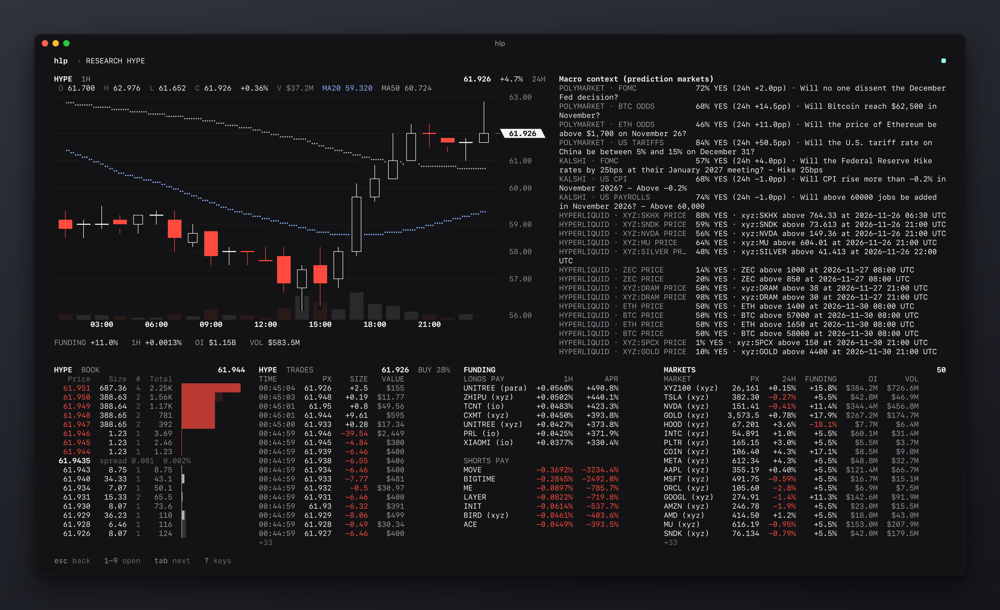
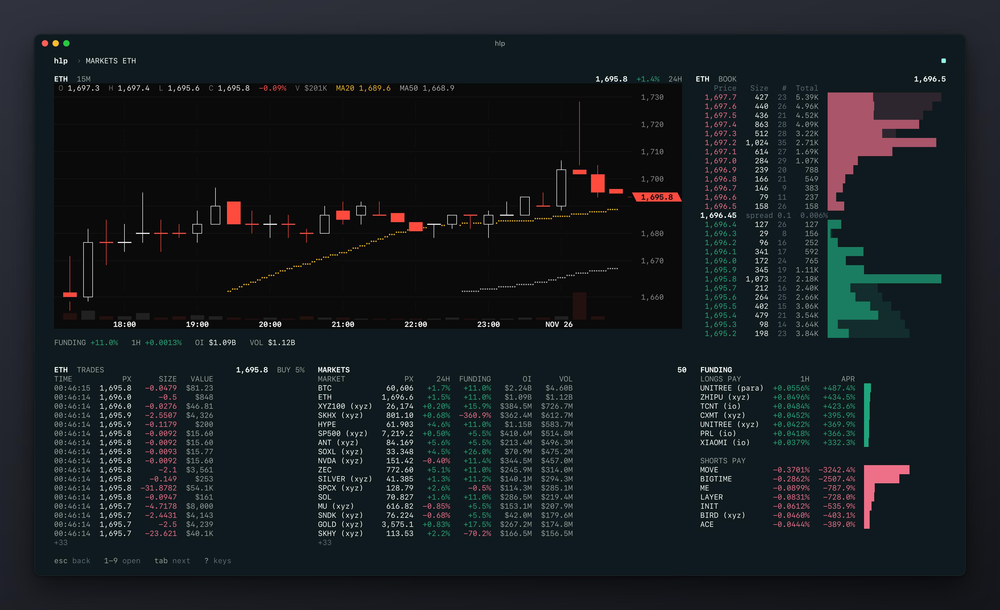
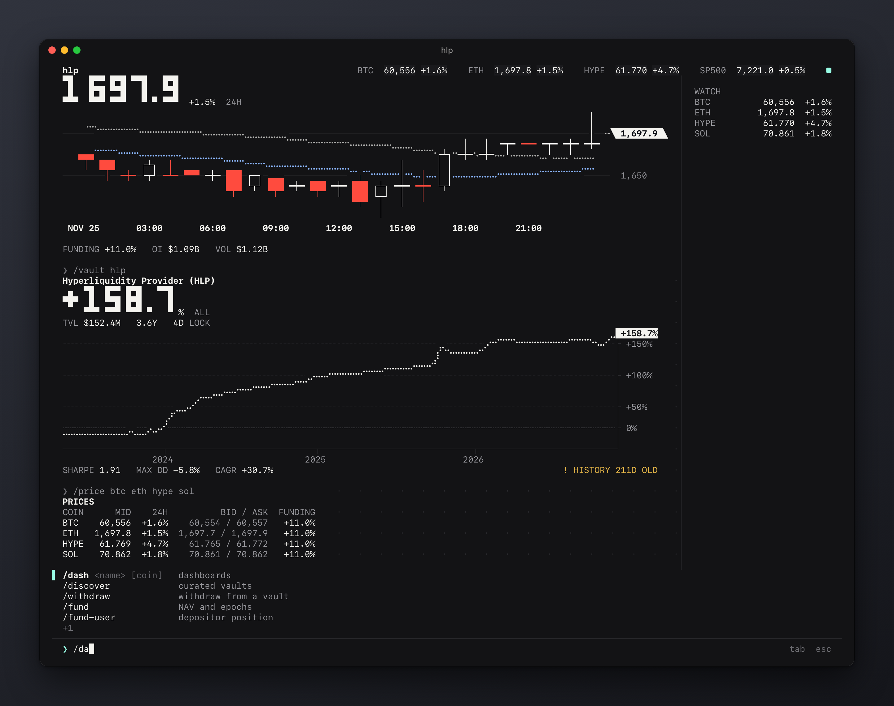
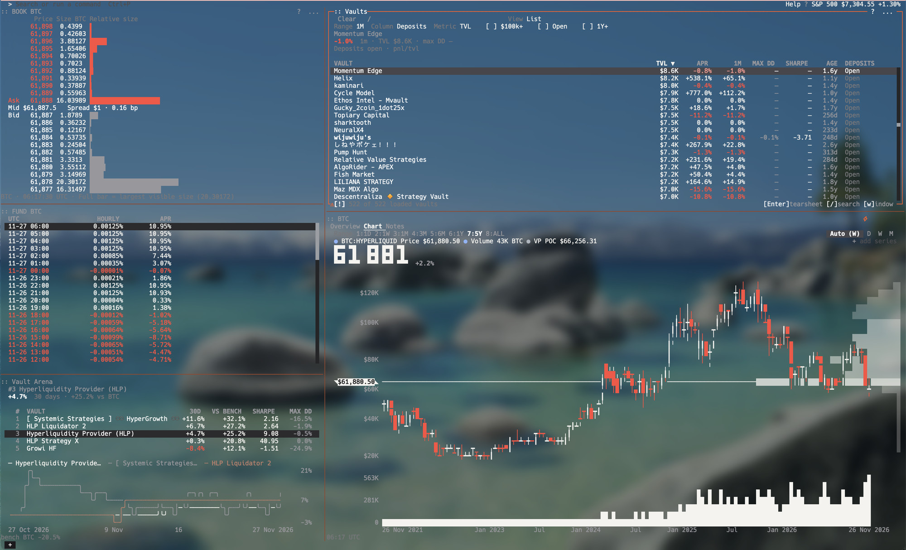
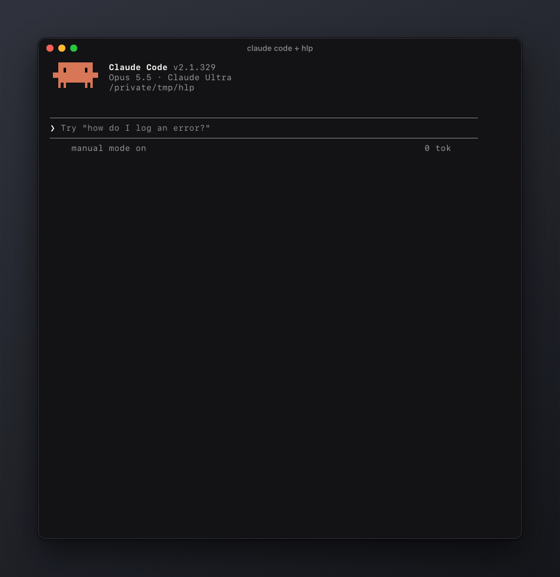

<div align="center">

# hlp cli

**The Hyperliquid terminal. Live charts, every vault, backtests and AI agents, in your shell.**

[](#ai-agents)
[](#install)
[](#safety)
[](LICENSE)



```sh
curl -fsSL https://raw.githubusercontent.com/maxmoneycash/hlp-cli/main/install.sh | sh
```

No keys. No account. No sign-up. Then run `hlp` and type `/dash`.

Plug it into Claude Code, Cursor or Codex: `claude mcp add hlp -- hlp mcp`

[Screenshots](#screenshots) · [Try it](#try-it) · [AI agents](#ai-agents) · [Install](#install) · [Guide](docs/GUIDE.md) · [Safety](#safety)

</div>

## Screenshots

| | |
|---|---|
| <br>**Markets** | <br>**Vaults** |
| <br>**HLP** | <br>**Strategies** |
| <br>**Research** | <br>**Hyperliquid theme** |
| <br>**Paper theme** | <br>**Heikin-Ashi** |
| <br>**Shell** | <br>**In Warp** |

## Try it

```sh
hlp                                            # the shell: /dash, /chart HYPE 15m, /vault hlp
hlp price btc eth hype                         # mid, bid/ask, 24h change, funding
hlp chart BTC 1h                               # candles in your terminal
hlp vaults --min-tvl 100k --sort sharpe        # every vault over $100k, ranked
hlp vault compare hlp "Long HYPE & BTC"        # curves, metrics, correlation
hlp backtest --thesis "long BTC, short DOGE FARTCOIN, rebalance 1w" --days 90
hlp arena --vaults hlp,"Long HYPE & BTC"       # real vaults head to head
```

Pipe anything and it prints JSON: `hlp vaults --select name,tvl,sharpe --limit 5 | jq`

| | |
|---|---|
| [Charts](docs/GUIDE.md#charts) | Any perp, spot or HIP-3 market (`xyz:SP500`), ten themes, live order book |
| [Vaults](docs/GUIDE.md#vault-analytics) | Screener over every vault, tearsheets, compare, what HLP holds right now |
| [Backtests](docs/GUIDE.md#strategy-vaults-and-thesis-backtests) | A thesis in plain English or YAML, with Hyperliquid fees and hourly funding |
| [Pine](docs/GUIDE.md#pine-import) | Paste a TradingView strategy and run it on Hyperliquid candles |
| [Arena](docs/GUIDE.md#ai-vs-ai-arena) | LLMs, Pine scripts and theses trading one live feed on paper |

## AI agents



35 tools over MCP, none of which can trade. Answers come back sized for an agent's context.

```sh
claude mcp add hlp -- hlp mcp        # Claude Code
codex mcp add hlp -- hlp mcp         # Codex
```

Cursor: `{"mcpServers": {"hlp": {"command": "hlp", "args": ["mcp"]}}}` in `~/.cursor/mcp.json`.

Then ask: *"Find Hyperliquid vaults over $1M with drawdown under 20% that beat HLP risk-adjusted."*

No MCP? The CLI is the API: JSON on stdout, typed errors with hints, `hlp schema` for every input and
output. `hlp skill --install claude` adds the [skill](skills/hlp/SKILL.md). Contract: [AGENTS.md](AGENTS.md).

## Install

```sh
curl -fsSL https://raw.githubusercontent.com/maxmoneycash/hlp-cli/main/install.sh | sh  # macOS and Linux, verifies SHA-256
go install github.com/maxmoneycash/hlp-cli/cmd/hlp@latest                               # Go 1.27+
```

<details>
<summary>Binaries, checksums, provenance, from source</summary>

Download a binary from [Releases](https://github.com/maxmoneycash/hlp-cli/releases) and check it against
`checksums.txt`. Every archive carries signed build provenance:
`gh attestation verify hlp_<version>_<os>_<arch>.tar.gz -R maxmoneycash/hlp-cli`, or run `install.sh` with
`HLP_INSTALL_VERIFY=1`. Archives include shell completions and the licences of every bundled dependency.
Binaries are not notarized yet; the Windows `.exe` is unsigned, so SmartScreen may warn on first run.

```sh
git clone https://github.com/maxmoneycash/hlp-cli && cd hlp-cli
make build          # writes bin/hlp
```

</details>

## Safety

Pre-release. All data is live mainnet data, read from public APIs. **Trading is dry-run in this
build:** orders are built, risk-checked and previewed, never sent (sending is compiled out).
Backtests, paper sessions and the arena never place orders and need no keys. No telemetry, nothing
custodial, no builder fee. Details: [Safety](docs/GUIDE.md#safety).

## More

[Guide](docs/GUIDE.md) · [AGENTS.md](AGENTS.md) · [Architecture](docs/ARCHITECTURE.md) · [Changelog](CHANGELOG.md) · [Contributing](CONTRIBUTING.md) · [Security](SECURITY.md)

Built on [Charm](https://charm.sh)'s Bubble Tea and Lip Gloss, with data from
[Hyperliquid](https://hyperliquid.xyz) and [hlp.xyz](https://www.hlp.xyz), by the hlp.xyz team.
MIT licensed. Not financial advice.
